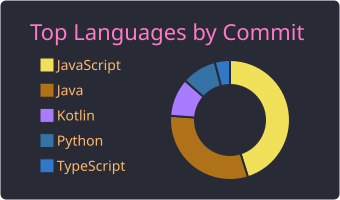
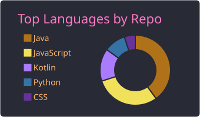

<h1 align="left">Hi 👋 What's up?</h1>

###

My name is Emerson Mendes and I'm a Software Engineer, from Brazil

###

<h2 align="left">About me</h2>

###

✨ Breaking stuff since 2012 📚 Learning AI and loving the chaos 🎲 Fun fact: I lived in New Zealand (2014–2015) and in Portugal (2021–2024).

###

<h2 align="left">I code with</h2>

###

  
  
  
  
  
  
  
  
  
  
  
  
  
  
  
  
  
  
  
  
  
  
  
  
  
  
  
  
  
  
  
  
  
  
  
  
  

###

<h2 align="left">Connect with me</h2>

###

<h3 align="left"></h3>

###

  
  

###

  

###

